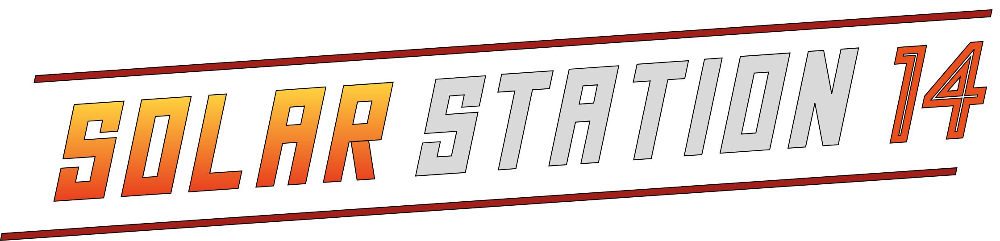

<!--
SPDX-FileCopyrightText: 2017 PJB3005 <pieterjan.briers@gmail.com>
SPDX-FileCopyrightText: 2018 Pieter-Jan Briers <pieterjan.briers@gmail.com>
SPDX-FileCopyrightText: 2019 Ivan <silvertorch5@gmail.com>
SPDX-FileCopyrightText: 2019 Silver <silvertorch5@gmail.com>
SPDX-FileCopyrightText: 2020 Injazz <43905364+Injazz@users.noreply.github.com>
SPDX-FileCopyrightText: 2020 RedlineTriad <39059512+RedlineTriad@users.noreply.github.com>
SPDX-FileCopyrightText: 2020 Víctor Aguilera Puerto <zddm@outlook.es>
SPDX-FileCopyrightText: 2021 Paul Ritter <ritter.paul1@googlemail.com>
SPDX-FileCopyrightText: 2021 Swept <sweptwastaken@protonmail.com>
SPDX-FileCopyrightText: 2021 mirrorcult <lunarautomaton6@gmail.com>
SPDX-FileCopyrightText: 2022 Pieter-Jan Briers <pieterjan.briers+git@gmail.com>
SPDX-FileCopyrightText: 2022 ike709 <ike709@users.noreply.github.com>
SPDX-FileCopyrightText: 2023 iglov <iglov@avalon.land>
SPDX-FileCopyrightText: 2024 Aidenkrz <aiden@djkraz.com>
SPDX-FileCopyrightText: 2024 Kira Bridgeton <161087999+Verbalase@users.noreply.github.com>
SPDX-FileCopyrightText: 2024 Rares Popa <2606875+rarepops@users.noreply.github.com>
SPDX-FileCopyrightText: 2024 router <messagebus@vk.com>
SPDX-FileCopyrightText: 2025 Aiden <28298836+Aidenkrz@users.noreply.github.com>
SPDX-FileCopyrightText: 2025 Piras314 <p1r4s@proton.me>

SPDX-License-Identifier: AGPL-3.0-or-later
-->

# Solar Station

Solar Station is a continuation of [Goob Station](https://github.com/Goob-Station/Goob-Station), a fork of [Space Station 14](https://github.com/space-wizards/space-station-14). We build on Goob's code and assets and focus on one thing: making the game more fun to play.

That means:

- Picking up features, bounties and ideas the Goob community wants, and shipping them fast.
- Fixing bugs before polishing internals.
- Player fun first. If it makes rounds better, it's in scope.

No Discord, website or public server yet. They'll show up here once they exist.

## Contributing

Anyone is welcome to contribute. Grab something from the [issues](https://github.com/Paul44ur/Solar-Station/issues) or bring your own idea and open a PR. Not sure about something? Ask in the issue or the PR.

Please follow the [Space Station 14 pull request guidelines](https://docs.spacestation14.com/en/general-development/codebase-info/pull-request-guidelines.html).

We don't accept translations on the main repository. If you want to translate the game, make a fork or contribute to one.

## AI-assisted contributions

AI-assisted code is allowed. The rules are the same as for any other code: it has to work, it can't make the game worse for players, and it can't trash the codebase. Test your changes and make sure you understand what you're submitting.

## Building

1. Clone this repo.
2. Run `RUN_THIS.py` to init submodules and download the engine.
3. Compile the solution.

## Credits

Solar Station exists thanks to the [Goob Station](https://github.com/Goob-Station/Goob-Station) contributors and the [Space Wizards](https://github.com/space-wizards) team behind Space Station 14. Most of the code and assets here are theirs. Go check them out.

## License

All code in this codebase is released under the AGPL-3.0-or-later license. Each file includes REUSE Specification headers or separate .license files that specify a dual license option. This dual licensing is provided to simplify the process for projects that are not using AGPL, allowing them to adopt the relevant portions of the code under an alternative license. You can review the complete texts of these licenses in the LICENSES/ directory.

Most media assets are licensed under [CC-BY-SA 3.0](https://creativecommons.org/licenses/by-sa/3.0/) unless stated otherwise. Assets have their license and the copyright in the metadata file. [Example](https://github.com/space-wizards/space-station-14/blob/master/Resources/Textures/Objects/Tools/crowbar.rsi/meta.json).

Note that some assets are licensed under the non-commercial [CC-BY-NC-SA 3.0](https://creativecommons.org/licenses/by-nc-sa/3.0/) or similar non-commercial licenses and will need to be removed if you wish to use this project commercially.
